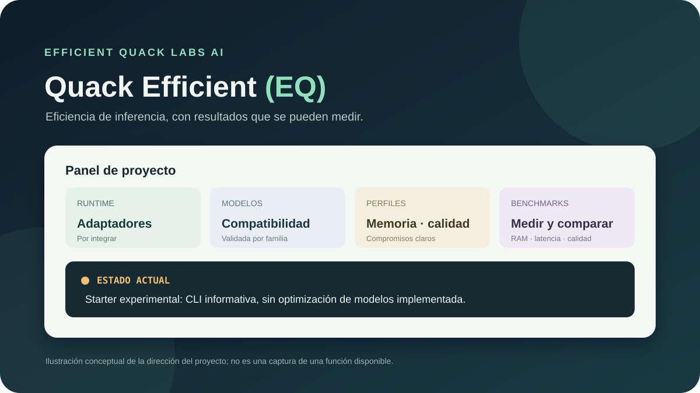

# Quack Efficient (EQ)

**Efficient Quack Labs AI · programa local para conversar con modelos servidos por Ollama y ajustar el contexto de inferencia.**

> **Proyecto financiado por Quack Labs y FLX.**

> **Qué ofrece esta versión:** una aplicación web local de un solo archivo (`index.html`). Detecta los modelos que Ollama tiene instalados, permite conversar con modelos que admiten su API de chat y ofrece perfiles con distinto tamaño de contexto y opción de descargar el modelo al terminar.

> **Límite importante:** EQ no comprime los pesos del modelo y no puede garantizar una reducción fija de RAM ni compatibilidad con cualquier modelo o formato. El perfil de ahorro reduce el contexto solicitado y puede liberar memoria al descargar el modelo; el efecto depende de Ollama, del modelo y del hardware.

## Compatibilidad

| Tipo de modelo | Compatibilidad de EQ |
| --- | --- |
| Modelos locales que aparecen en la lista de Ollama y admiten `/api/chat` | Se pueden seleccionar y probar desde EQ; cada modelo debe evaluarse en el equipo donde se usa. |
| Qwen, MiniMax y modelos propios importados en Ollama | Aparecerán si están instalados y expuestos por Ollama. EQ no afirma haber probado todas sus variantes. |
| Modelos de otros runtimes, archivos de modelo que Ollama no puede cargar, APIs remotas ajenas a Ollama y modelos solo de embeddings | No compatibles directamente con esta versión de EQ. |
| Modelos de Ollama que no admiten chat | Pueden aparecer en la lista, pero el envío puede fallar; EQ informa del error. |

EQ consulta la API local de Ollama para leer la lista de modelos y enviar los mensajes seleccionados. Las opciones `num_ctx` y `num_predict` ajustan el contexto y el máximo de tokens de salida de la petición. `keep_alive: 0` pide a Ollama descargar el modelo al terminar. Consulta la [API oficial de Ollama](https://docs.ollama.com/api) y la [documentación de parámetros](https://docs.ollama.com/modelfile#valid-parameters-and-values).

## Descarga y puesta en marcha

### Requisitos

- Ollama instalado y abierto en el mismo ordenador.
- Al menos un modelo descargado o importado en Ollama.
- Un navegador moderno (Chrome, Edge o Firefox actualizado).
- No requiere Python, Node, instalación de dependencias ni cuenta de EQ.

### Pasos

1. En GitHub pulsa **Code → Download ZIP** y extrae el ZIP.
2. Abre `index.html` con tu navegador (doble clic en Windows suele bastar).
3. Deja la dirección local predeterminada `http://localhost:11434` y pulsa **Conectar**.
4. Elige un modelo de la lista que devuelve Ollama.
5. Selecciona **Ahorro** para pedir 2.048 tokens de contexto y hasta 256 tokens de respuesta. Elige **Descargar modelo al terminar** si quieres que Ollama lo retire de memoria después de responder.
6. Escribe una pregunta y pulsa **Enviar**.

Los modelos y conversaciones permanecen en Ollama y en la pestaña local. EQ no envía solicitudes a servidores de Quack Labs, FLX ni OpenAI. La dirección del servidor se restringe a `localhost` o `127.0.0.1` para evitar enviar el contenido a una dirección remota accidentalmente.

Si el navegador informa de un error de conexión, comprueba primero que Ollama esté abierto y que `http://localhost:11434/api/version` responda. EQ usa la API local documentada por Ollama; las versiones antiguas pueden tener diferencias de API u orígenes permitidos. Actualiza Ollama si fuera necesario.

## Perfiles de memoria

- **Ahorro:** `num_ctx=2048`, `num_predict=256`; solicita menos contexto y limita la respuesta.
- **Equilibrado:** `num_ctx=4096`, `num_predict=512`.
- **Personalizado:** permite elegir el contexto entre 1.024 y 8.192 y la longitud de respuesta.
- **Descargar modelo al terminar:** usa `keep_alive=0`; libera la memoria ocupada por el modelo tras la respuesta y hace que la próxima carga pueda tardar más.

Reducir contexto puede reducir la memoria de trabajo, sobre todo la caché KV, pero el modelo todavía necesita sus pesos y el resto de la memoria de ejecución. No se aplica una conversión ni una cuantización a los archivos originales. Un contexto menor también limita cuánto historial puede aprovechar el modelo. EQ no promete que una configuración concreta quepa en la RAM disponible.

## Archivo incluido

- `index.html`: aplicación EQ completa (interfaz y conexión a la API local de Ollama).
- `assets/eq-overview.svg`: ilustración conceptual para el README.
- `docs/estado-y-alcance.md`: alcance, compatibilidad y límites comprobables.
- `src/eq/`: CLI de diagnóstico original, conservada como scaffold experimental.
- `pyproject.toml`: metadatos del scaffold Python.

## Estado de las pruebas

La aplicación consulta los modelos y versiones reales que expone el servidor Ollama en el equipo del usuario. La compatibilidad de cada modelo depende de que Ollama lo liste y acepte `/api/chat`. La reducción real de RAM debe medirse en ese equipo antes y después, con el mismo modelo, prompt, contexto y carga.

El entorno de desarrollo donde se preparó este repositorio no pudo conectar con `localhost:11434` ni ejecutar Python; por tanto, aquí no se ha certificado la comunicación con una instancia real de Ollama ni el ahorro en modelos concretos. No marques un modelo como probado sin registrar versión de Ollama, modelo/tag, sistema, hardware, tamaño de contexto y resultados medidos.

## Financiación

**Proyecto financiado por Quack Labs y FLX.**

## Licencia

Este starter no incluye una licencia de software revisada. El borrador de política del ZIP original tenía un correo sin completar, por lo que no se publica como licencia válida. Las licencias de Ollama, modelos y componentes de terceros se aplican por separado.

## Atribución

Quack Efficient (EQ) — Efficient Quack Labs AI. Concepto y atribución original: Quack Labs.

